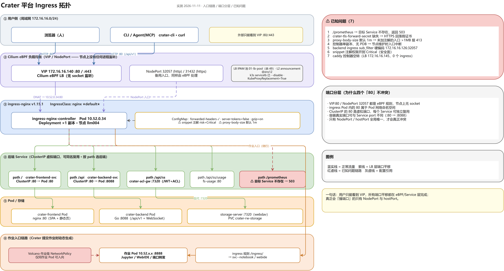
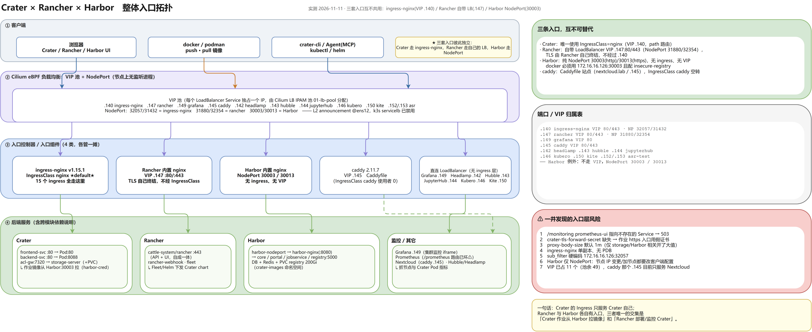

# 集群 Ingress 拓扑（2026-11-11 实测）



> 可编辑源文件：`diagrams/ingress-topology.drawio`（draw.io 打开可直接改）
> 矢量版：`diagrams/ingress-topology.svg`　·　生成工具：`drawio-skill`（draw.io CLI 导出）

```
                                  ┌──────────────────────────────┐
   用户浏览器 / CLI ──HTTP──▶     │  VIP  172.16.16.140    :80   │      （HTTPS :443 亦可，无证书→浏览器告警）
   (局域网 172.16.16.0/24)        └──────────────┬───────────────┘
                                                 │  ARP/L2 宣告（Cilium L2 announcement）
                                                 │  IP 由 Cilium LB IPAM 池 01-lb-pool 分配
                                                 │  （k3s 自带 servicelb 已 --disable）
┌────────────────────────────────────────────────▼─────────────────────────────────────────────┐
│  ingress-nginx  v1.15.1   IngressClass: nginx  ★default★                                     │
│  ├─ Deployment ingress-nginx-controller  副本 1  →  节点 llm004  (Pod 10.52.0.34)            │
│  ├─ Service  LoadBalancer  80→NodePort 32057   443→NodePort 31432   8443=admission webhook    │
│  └─ ConfigMap: use-forwarded-headers / server-tokens=false / gzip=on /                         │
│                allow-snippet-annotations=TRUE + risk-level=Critical ⚠️                        │
│                proxy-body-size 未设 → 默认 1m ⚠️                                               │
└───────┬─────────────────────┬──────────────────────┬──────────────────────────┬──────────────┘
        │ path: /             │ path: /api           │ path: /api/ss           │ path: /prometheus
        ▼                     ▼                      ▼                          ▼
┌───────────────────┐ ┌────────────────────┐ ┌──────────────────────┐ ┌──────────────────────┐
│ crater-frontend-  │ │ crater-backend-svc │ │  crater-acl-gw :7320 │ │ （Service 不存在）    │
│ svc :80           │ │ :80  → Go 后端     │ │  校验 JWT + 查 ACL   │ │ prometheus-ui  → 503 │
│ React SPA +       │ │ /api/v1/** + ws    │ └──────────┬───────────┘ │ ⚠️                   │
│ crater-mcp-guide  │ │ 注解 sub_filter：  │            ▼             └──────────────────────┘
└───────────────────┘ │ 172.16.16.126:32057│ ┌──────────────────────┐
                      │  → 172.16.16.140⚠️ │ │ storage-server :7320 │
                      └────────────────────┘ │ (webdav-service)     │
                                             │ PVC crater-rw-storage│
                                             └──────────────────────┘

┌───────────────────── 作业入口（Crater 后端在创建作业时动态生成）─────────────────────────────┐
│                                                                                              │
│  path /ingress/<baseURL>            → svc-<baseURL>-notebook :8888   （Jupyter）              │
│  path /ingress/<baseURL>-<prefix>/(.*) → svc-...-webide :8888        （WebIDE，regex 重写）   │
│  exact /ingress/<baseURL>-<prefix>  → 308 跳转（configuration-snippet）                       │
│  host <prefix>.172.16.16.140        → 同上（host 型，带 TLS ⚠️ crater-tls-forward-secret 缺失）│
│                                                                                              │
│            ingress-nginx ──────▶ 作业 Pod (10.52.x.x)                                        │
│                                   ▲                                                          │
│                                   │  ⚠️ 每个作业自带 NetworkPolicy（Volcano 创建）：          │
│                                   │     只允许「同一作业的 Pod」入向，其它全部丢弃            │
│                                   └─ 必须先有 allow-ingress-nginx-web-access 才能通           │
└──────────────────────────────────────────────────────────────────────────────────────────────┘

       ┌──────────────── 旁路：空转的第二控制器 ────────────────┐
       │ IngressClass: caddy  →  caddy-system/caddy:2.11.7      │
       │ Service LoadBalancer 172.16.16.145 :80/:443            │
       │ 使用者：0 个 ingress  ⚠️ 白占一个 LB IP                 │
       └────────────────────────────────────────────────────────┘
```

## 图例

| 标记 | 含义 |
| --- | --- |
| ★default★ | 未指定 `ingressClassName` 的 ingress 都落到它 |
| ⚠️ | 已确认的问题（见下表） |

## 逐条路径 → 后端

| 入口 | Ingress | 后端 | 状态 |
| --- | --- | --- | --- |
| `/` | `crater/crater-frontend-ingress` | `crater-frontend-svc:80` | ✅ |
| `/api` | `crater/crater-backend-ingress` | `crater-backend-svc:80` | ✅（含 sub_filter hack） |
| `/api/ss` | `crater-workspace/storage-server-ingress`（body 1000m） | `crater-acl-gw:7320` → `storage-server` | ✅ |
| `/api/ss/usage` | `crater-workspace/fs-usage-api` | `fs-usage:80` | ✅ |
| `/assets` | `crater/crater-frontend-assets-cache` | `crater-frontend-svc:80` | ✅ |
| `/ingress/<baseURL>` | `ing-*-notebook` | `svc-*-notebook:8888` | ✅（需放行策略） |
| `/ingress/<baseURL>-<prefix>/(.*)` | `ing-webide-path-*` | `svc-*-webide:8888` | ✅（需放行策略） |
| `/prometheus`、`/alertmanager` | `monitoring/prometheus-ui` | `prometheus-kube-prometheus-prometheus:9090` 等 | ❌ **503，Service 不存在** |
| `host:<prefix>.<IP>` | `ing-crater-admin-249a4-ocr-api`、`ing-crater-admin-add28-1-webide` | 作业 Service | ⚠️ TLS Secret 缺失 |

## 问题汇总

| # | 问题 | 影响 | 修法 |
| --- | --- | --- | --- |
| 1 | `/prometheus` 指向不存在的 Service | 页面 503，集群监控这块入口不可用 | 改成实际 Prometheus Service 名或删掉该 ingress |
| 2 | `crater-tls-forward-secret` 不存在（2 个 host 型作业入口引用） | 控制器持续报错、HTTPS 回落到假证书 | 建 Secret + 证书，或去掉 `spec.tls` |
| 3 | `proxy-body-size` 未全局设置（默认 1m） | 未加注解的上传 >1MB 会 413 | 在 ConfigMap 设全局值（如 100m） |
| 4 | 控制器单副本、无 PDB | 节点维护时入口中断 | 副本 ≥2 + PDB |
| 5 | `sub_filter` 硬编码 `172.16.16.126:32057` | NodePort 变更即失效，且内部地址写死 | 改成按 `$http_host` 或配置注入 |
| 6 | `allow-snippet-annotations=true` + risk=Critical | 任何能建 ingress 的人可改 nginx 行为 | 收紧到指定 namespace |
| 7 | caddy 控制器空转（0 个 ingress） | 白占 LB IP 172.16.16.145 | 确认用途后下线 |

---

## 附：结合 Rancher / Harbor 的整体入口拓扑



> 可编辑源文件：`diagrams/platform-ingress-topology.drawio`　·　矢量：`diagrams/platform-ingress-topology.svg`

**核心结论：三套入口互不共用**

| 平台 | 入口方式 | 地址 | 是否经过 ingress-nginx |
| --- | --- | --- | --- |
| Crater | IngressClass `nginx`（唯一使用者） | VIP `172.16.16.140:80/443`（NP 32057/31432） | ✅ 是 |
| Rancher | 自带 LoadBalancer（TLS 自己终结） | VIP `172.16.16.147:80/443`（NP 31880/32354） | ❌ 否 |
| Harbor | 纯 NodePort | `172.16.16.126:30003`(http) / `:30013`(https) | ❌ 否（无 ingress、无 VIP） |
| caddy | 自己的 Caddyfile 站点 | VIP `172.16.16.145`（nextcloud.lab） | ❌ 否（class `caddy` 使用者为 0） |
| Grafana / Headlamp / Hubble / JupyterHub / Kubero / Kite / asr | 直连 LoadBalancer | .149 / .142 / .143 / .144 / .146 / .150 / .152–.153 | ❌ 否（无 ingress 层） |

VIP 池共 11 个已占用（Cilium LB IPAM，余 49）。

三者唯一的交集：

1. **Crater 作业 → 从 Harbor 拉镜像**（`imagePullSecret: harbor-cred`，指向 `172.16.16.126:30003`）；
2. **Crater 构建 → 推镜像到 Harbor**（buildkit 流水线）；
3. **Rancher / Fleet → 部署与纳管 Crater**（`cattle-fleet-*` / Helm chart）；
4. **Grafana/Prometheus → 抓节点与 Crater Pod 指标**（Crater「集群监控」页 iframe）。
