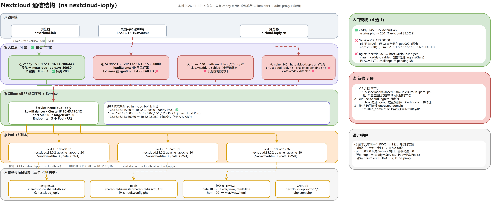

# Nextcloud 通信结构（2026-11-12 实测）



> 可编辑源：`diagrams/nextcloud-topology.drawio`　·　矢量：`diagrams/nextcloud-topology.svg`

## 结论先说

**4 条入口里只有 caddy 那一套真的能用**；全链路都经 Cilium eBPF（kube-proxy 已 `--disable`，`KubeProxyReplacement: True`）。

| # | 入口 | 状态 | 证据 |
| --- | --- | --- | --- |
| ① | caddy VIP `172.16.16.145:80/443` → `nextcloud-ioply.svc:50080` | ✅ **可用** | `curl /status.php` → 200，`{"version":"35.0.2.2"}` |
| ② | Service LB VIP `172.16.16.153:50080`（`spec.loadBalancerIP` 手工钉死） | ❌ 不可达 | eBPF 有映射，但 L2 lease 在 **gpu002**（网卡 `enp129s0f0`），llm002 上 `172.16.16.153 → ARP FAILED` |
| ③ | ingress-nginx `.140` `path /nextcloud/(.*)` | ❌ 无人实现 | `ingressClassName: caddy-disabled`，集群只有 `caddy` / `nginx` 两个 IngressClass |
| ④ | ingress-nginx `.140` `host aicloud.ioply.cn`（TLS） | ❌ 无人实现 + 证书未签 | 同上；`Certificate aicloud-ioply-tls=False`，order/challenge `pending` 5h+，solver Pod 常驻 |

## 组件与依赖

| 项 | 值 |
| --- | --- |
| 工作负载 | Deployment `nextcloud-ioply` ×**3**，镜像 `nextcloud:35.0.2-apache`，容器端口 **80** |
| Service | `nextcloud-ioply`，LoadBalancer，ClusterIP `10.43.170.12`，`50080 → 80` |
| Endpoints | `10.52.0.82` / `10.52.1.51` / `10.52.2.236`（3 个 Pod，轮询） |
| 数据库 | 外部共享 PG `shared-pg-rw.shared-db.svc`，库 `nextcloud_ioply`（账号密码走 Secret） |
| 缓存 | 共享 Redis `shared-redis-master.shared-redis.svc:6379`，额外挂 `zz-redis.config.php` |
| 存储 | `nextcloud-ioply-data` 100Gi RWX → `/var/www/html/data`；`nextcloud-ioply-html` 10Gi RWX → `/var/www/html` |
| 后台任务 | CronJob `nextcloud-ioply-cron` `*/5 * * * *` → `php /var/www/html/cron.php` |
| 探针 | `GET /status.php`（带 `Host: localhost`） |
| 反代适配 | `TRUSTED_PROXIES=10.52.0.0/16`；`trusted_domains = localhost, aicloud.ioply.cn` |

## eBPF 层的实际映射（`cilium-dbg bpf lb list`）

```
172.16.16.145:80/TCP      → 10.52.2.138:80        (caddy Pod)              ✅
10.43.170.12:50080/TCP    → 10.52.0.82 / .51 / .236 (3 个 nextcloud Pod)   ✅
172.16.16.153:50080/TCP   → 10.52.0.82:80         (有映射，但无人答 ARP)   ❌
```

## 待修

1. **VIP .153**：把 `spec.loadBalancerIP` 改成 `io.cilium/lb-ipam-ips: 172.16.16.153`，让 L2 宣告重新落到与客户端同网段的节点（llm002/003/004）；顺手清理 `asr-test` 历史占用。
2. **两个 nextcloud ingress**：要么 `ingressClassName` 改回 `nginx` 并把 `aicloud.ioply.cn` 证书签下来（需要 DNS + 公网 80 可达），要么直接删掉（含 Certificate / challenge / solver 残留）。
3. **trusted_domains** 补上实际使用的主机名/IP，否则按 IP 访问会报 `Access through untrusted domain`。

## 设计提醒

- 3 副本共享同一个 **RWX** `html` 卷：升级或改配置时容易出现"一半新一半旧"，官方不建议多副本共用 html 卷；
- `port 50080` 只是 Service 端口，容器始终是 `:80`（caddy / ingress 都指向 targetPort 80）；
- 所有 hop 都经 Cilium：`用户 → L2/VIP → DNAT`、`caddy → ClusterIP DNAT`、`Pod → PG/Redis ClusterIP DNAT`，没有任何 kube-proxy/iptables 参与。